[Български](README_bg.md)

# Pico-PAL-Test-Card-Generator

A broadcast-compliant hardware PAL (625-line, 50 Hz, interlaced) test signal generator built around a **YD-RP2040** board (a clone of the official Raspberry Pi Pico RP2040 with USB Type-C interface). It outputs a composite video signal on an RCA jack—including a digitally synthesised PAL colour subcarrier with an exact 8-field phase sequence and live **Teletext VBI** injection—plus a 1 kHz test tone on a second RCA jack. Eight test patterns are selectable with one push button, including the Philips **PM5544**, the Telefunken **FuBK**, the Grundig **VG1001** (Bulgarian BNT/Nova TV variant), and a **UEIT** card.

There is no video chip involved. The RP2040 clocks out 8-bit samples straight from RAM through PIO and DMA, at four times the PAL subcarrier frequency, into a resistor-ladder DAC. Everything—including sync, equalising pulses, colour burst, chroma, and Teletext—is computed in software across both RP2040 cores.

## Features

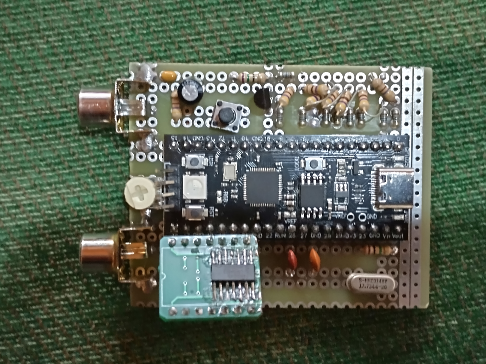
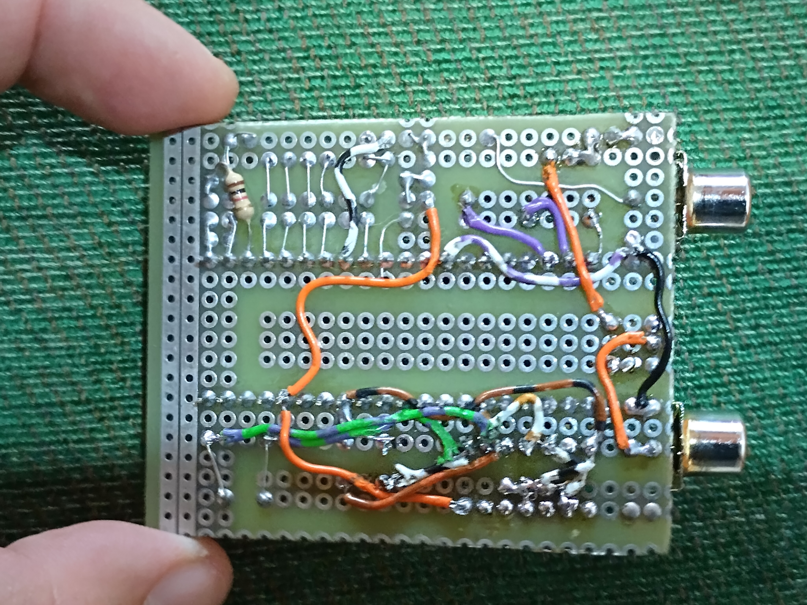
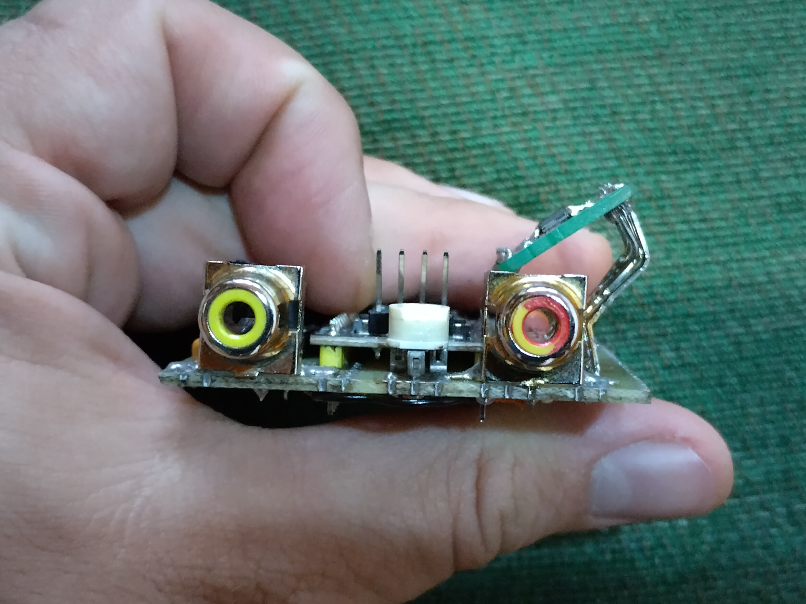
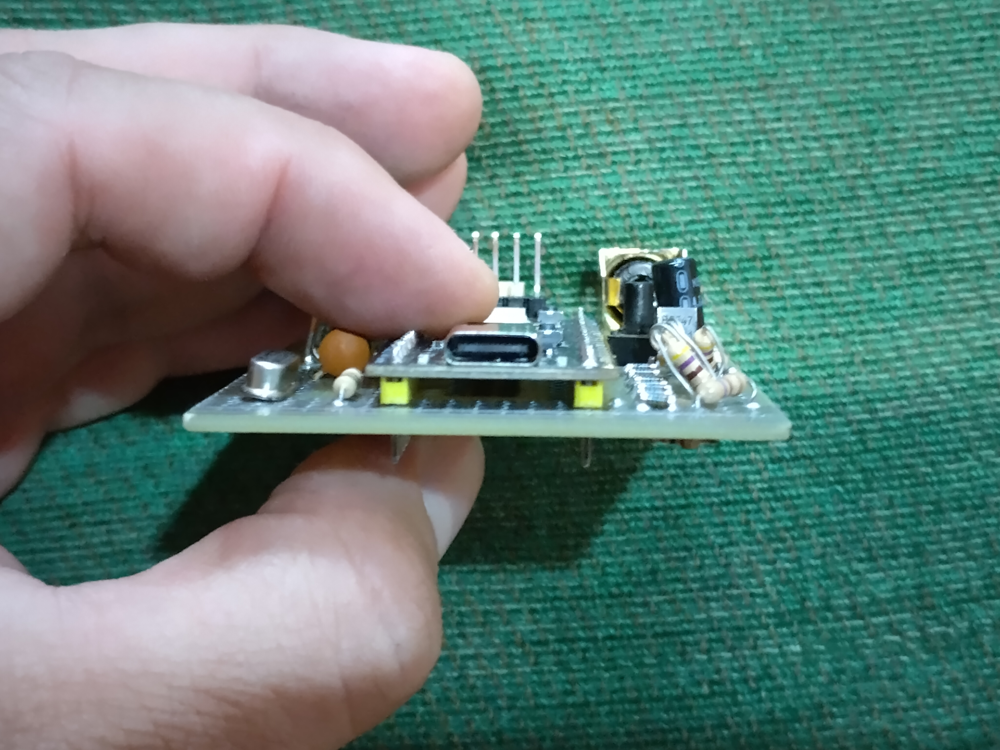
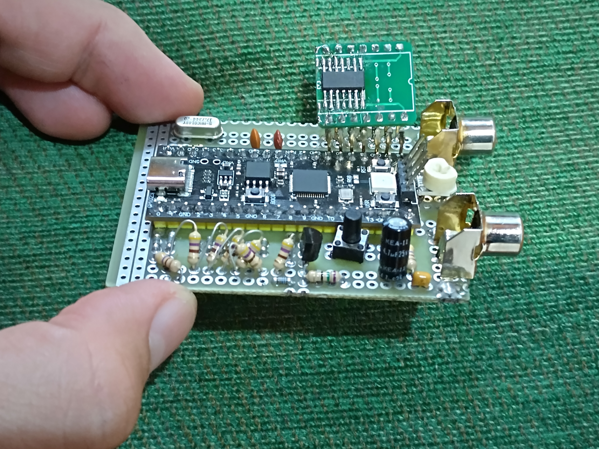

- Broadcast-compliant PAL composite video: exact 1,135 samples/line ($64.00\ \mu\text{s}$, $283.75$ subcarrier cycles/line), $-90^\circ$/line phase rotation, continuous 4-frame / 8-field (2,500-line) PAL sequence, sync, equalising pulses, colour burst, V-switch, and 2:1 interlace
- Compatible with CRT/LCD TVs, AV2HDMI converters, standard capture cards, and strict raw-capture software TBC pipelines such as **CXADC + `cvbs-decode`** (both 2D and 3D PAL comb filters)
- 8 test cards, cleanly switchable at runtime with a single push button (using a blanking curtain during rebuilds to prevent mid-switch tearing)
- Global **Teletext VBI** injection (ETS 300 706 Page 100) on lines 16–18 and 329–331 across all 8 test cards
- Dual-core architecture: **Core 1** is dedicated exclusively to zero-jitter SRAM video composition and DMA streaming, while **Core 0** handles button polling, heartbeat LED, and runtime card generation
- Pixel clock locked to a 17.734475 MHz crystal ($4 \times f_{sc}$), providing exact subcarrier phase relationships
- Pixel-exact circular masking (as on the original PM5544) with a 32-bit accelerated anti-gap outline
- In-place, zero-stack DSP filtering: 3-tap FIR luma filtering on templates and a 5-tap 4.43 MHz chroma notch filter on monochrome grid/checkerboard patterns to eliminate cross-color ringing
- 1 kHz sine test tone via PWM and DMA, with RC filtering and a volume potentiometer
- Heartbeat LED, which stays lit while the button is held (useful as a wiring check)

## Test cards

| # | Image | Card | Notes |
|---|-------|------|-------|
| 0 | 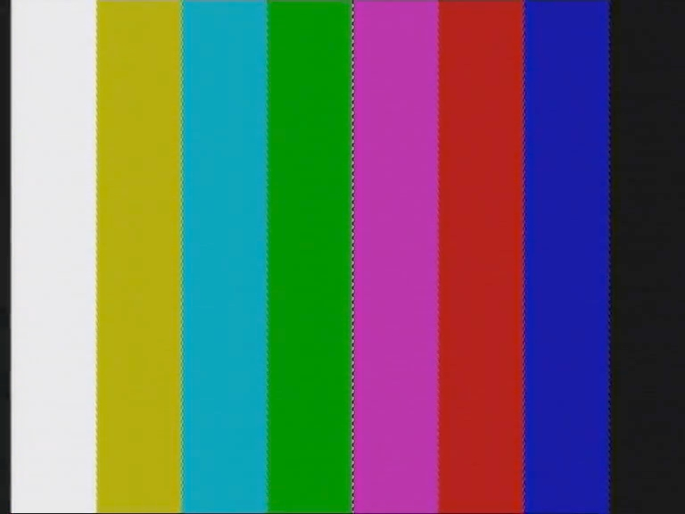 | EBU colour bars | Startup card; 100% bars with PAL burst |
| 1 | 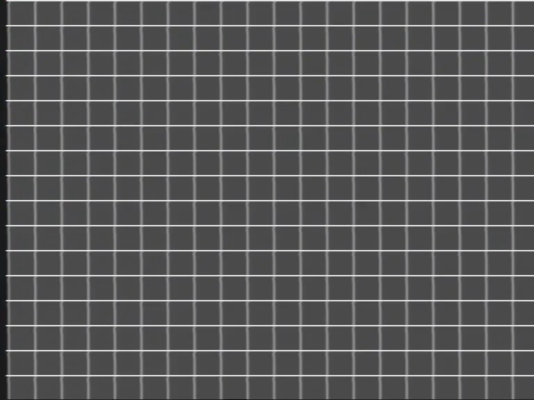 | Crosshatch | White grid on dark grey, 4.43 MHz chroma-notch filtered |
| 2 | 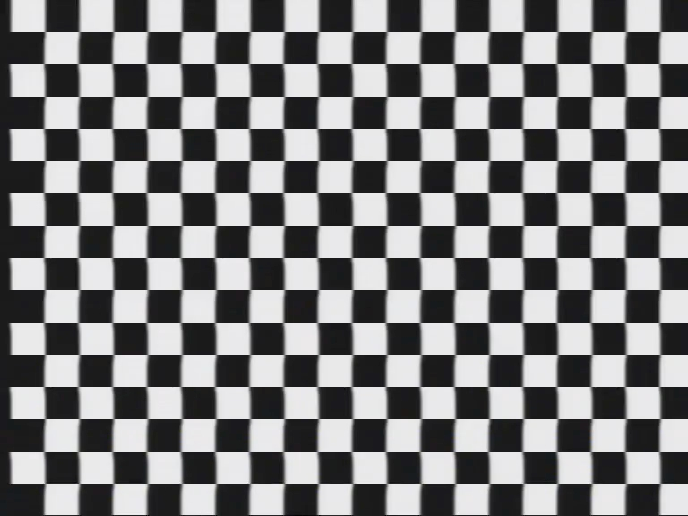 | Checkerboard | Black/white 47 px cells, 4.43 MHz chroma-notch filtered |
| 3 | 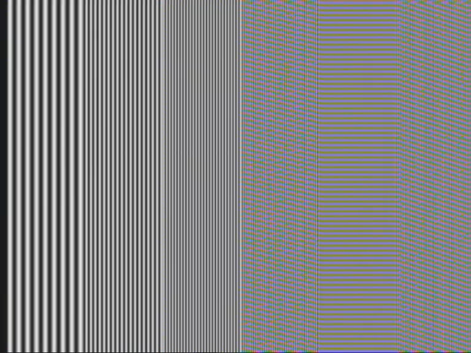 | Multiburst | Unfiltered 1.0, 2.0, 3.0, 4.0, 4.43, 5.0 MHz sine bursts for Y/C and bandwidth testing |
| 4 | 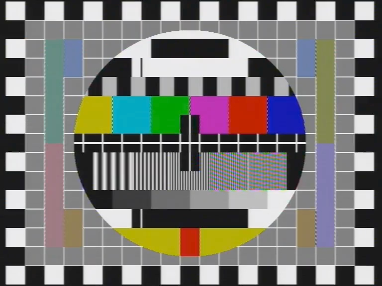 | **Philips PM5544** | Circular layout, LF/reflection checks, colour bars, gratings, grayscale, Y/C delay check, coloured side signals |
| 5 | 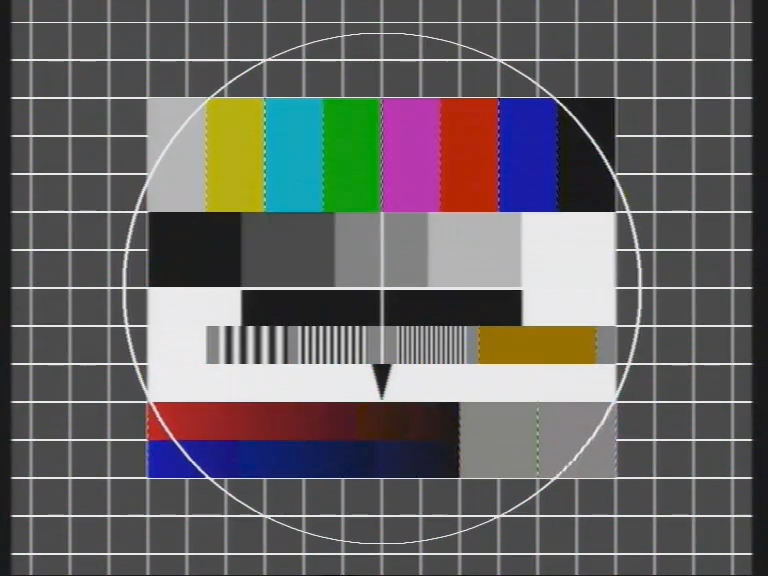 | **Telefunken FuBK** | Colour bars, grayscale, gratings, PAL test sectors, tapering triangle |
| 6 | 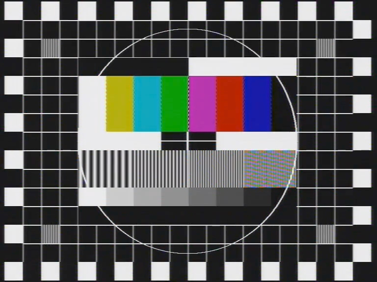 | **Grundig VG1001** (Bulgarian modification, used by BNT, "Nova TV", and "7 dni TV") | Castellated border, centre box with colour bars, gratings, grayscale |
| 7 | 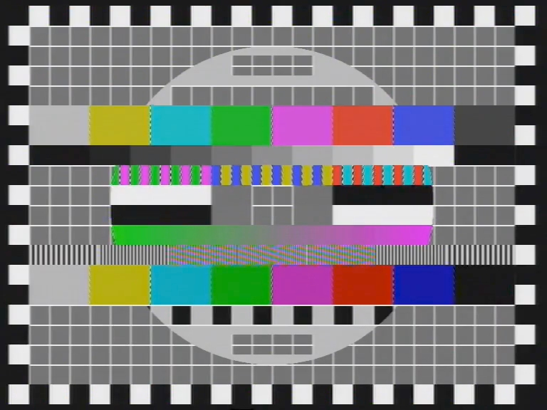 | **UEIT** | $26 \times 20$ cell grid, colour bars, grayscale, stripes, slanted/gradient fields, gratings (currently without corner circles) |

Press the button to step to the next card. After card 7 it wraps back to card 0.

## Hardware

### Circuit diagram

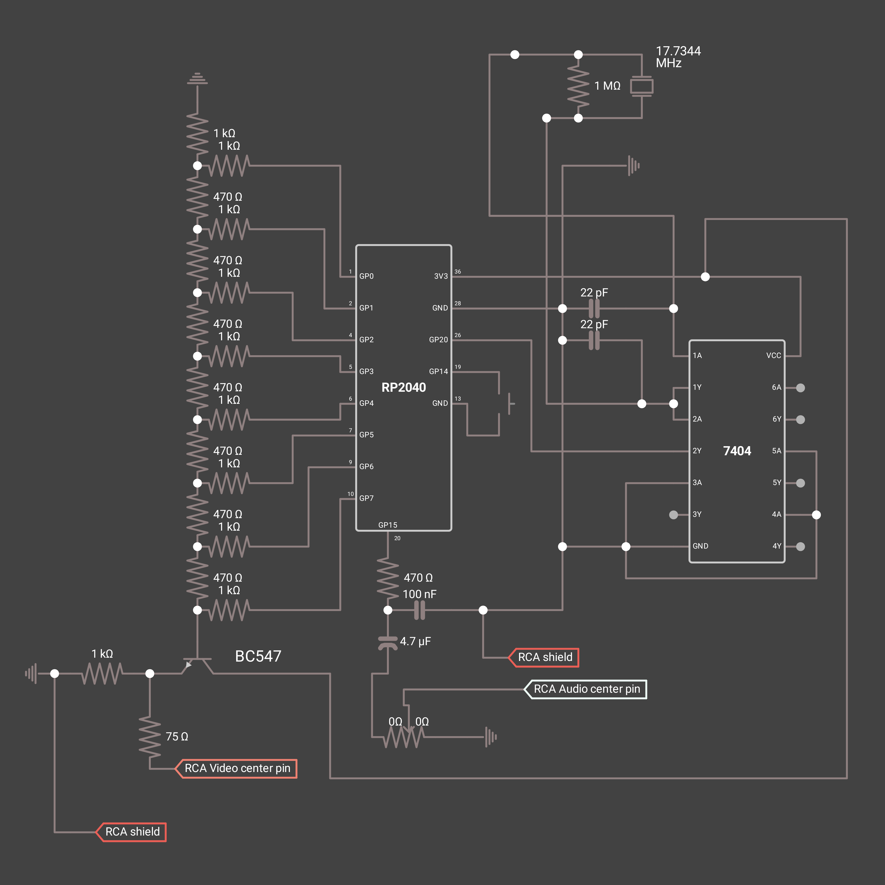

### Bill of materials

| Part | Value / type | Purpose |
|------|--------------|---------|
| U1 | YD-RP2040 board | Microcontroller (overclock-free, clocked externally) |
| U2 | 74HCU04D hex inverter | Crystal oscillator and clock buffer |
| Y1 | 17.7344 MHz crystal | Pixel clock ($4 \times$ PAL subcarrier, 17.734475 MHz nominal) |
| R | $1\text{ M}\Omega$ | Oscillator feedback |
| C | $2 \times 22\text{ pF}$ | Crystal load capacitors |
| R-2R ladder | $8 \times 1\text{ k}\Omega$, $8 \times 470\ \Omega$, $1 \times 1\text{ k}\Omega$ termination | 8-bit video DAC |
| Q1 | BC547 (NPN) | Emitter-follower output buffer |
| R | $1\text{ k}\Omega$ | Emitter pull-down |
| R | $75\ \Omega$ | Output series (source) impedance |
| C (optional) | $220\text{ pF}$ (ceramic, output to GND) | Reconstruction low-pass filter to attenuate the 13.3 MHz DAC sampling image |
| R | $470\ \Omega$ | Audio low-pass |
| C | $100\text{ nF}$ | Audio low-pass |
| C | $4.7\ \mu\text{F}$ | Audio DC blocking |
| RV1 | Potentiometer (volume) | Audio level |
| SW1 | Momentary push button | Card selection |
| J1, J2 | RCA jacks | Video and audio outputs |

### Pin map

| RP2040 pin | Function |
|------------|----------|
| GP0–GP7 | 8-bit video DAC (GP0 = LSB, GP7 = MSB) |
| GP14 | Card-select button (to GND, internal pull-up) |
| GP15 | Audio PWM output |
| GP20 | External clock input (from the 74HCU04 oscillator) |
| GPIO25 | On-board LED (heartbeat) |
| 3V3 / GND | Power for the 74HCU04, BC547 collector, and DAC reference |

### Clock

Two gates of the 74HCU04D are used. The first (1A to 1Y), with the $1\text{ M}\Omega$ feedback resistor, the crystal, and the two $22\text{ pF}$ capacitors, forms a Pierce oscillator. An unbuffered (U-type) inverter is used on purpose because it works as a linear amplifier in this role. The second gate (2A to 2Y) buffers the oscillator output and drives GP20. Unused gate inputs are tied off.

The RP2040 switches `clk_sys` directly to this external clock (`GPIN0` as the `clk_sys` aux source). The system clock is therefore locked to 17.734475 MHz, with one PIO instruction per pixel ($56.39\text{ ns}$ per sample).

### Video DAC and output stage

GP0–GP7 feed an R-2R style ladder ($1\text{ k}\Omega$ for the "2R" legs, $470\ \Omega$ for the "R" series elements, and a $1\text{ k}\Omega$ termination to ground). The ladder output drives the base of a BC547 emitter follower. The collector is tied to 3V3, and the emitter feeds a $1\text{ k}\Omega$ pull-down and a $75\ \Omega$ series resistor to the RCA centre pin, giving a $75\ \Omega$ source impedance. Adding a $220\text{ pF}$ ceramic capacitor between the composite output and ground is recommended for raw RF/baseband captures (such as CXADC) to smooth the 13.3 MHz DAC zero-order-hold staircase image without affecting the video passband.

Signal levels (8-bit DAC codes):

| Level | Code |
|-------|------|
| Sync tip | 70 |
| Black / blanking | 116 |
| Dark grey | 143 |
| Grey | 170 |
| Teletext high (66%) | 188 |
| White | 224 |

### Audio

GP15 outputs a PWM signal (wrap value 276, approximately 64 kHz carrier). A 64-entry sine table is looped into the PWM compare register by two chained DMA channels (data and control), producing a **1 kHz tone** with zero CPU overhead. A $470\ \Omega$ + $100\text{ nF}$ RC network filters the carrier, a $4.7\ \mu\text{F}$ capacitor blocks DC, and a potentiometer sets the output level at the RCA centre pin.

## How it works

### Video timing and 1,135-sample PAL cadence

- 625 lines per frame, 2:1 interlace, 576 visible lines
- **1,135 samples per line** at 17.734475 MHz = **$64.00\ \mu\text{s}$** ($283.75$ subcarrier cycles/line), matching the broadcast PAL line duration and $-90^\circ$/line phase advance
- Because 1,135 is not a multiple of 4 bytes, four consecutive lines ($4 \times 1135 = 4540\text{ bytes} = 1135\text{ 32-bit words}$) are streamed using a **`284, 284, 284, 283`-word** 32-bit DMA cadence
- `pack_line_1135()` shifts each `s_mod = line_idx & 3` line buffer left by `s_mod` bytes and pads the trailing 1–3 bytes with `SYNC_TIP` (the start of the next line's H-sync), preserving 32-bit DMA efficiency while outputting a bit-exact, phase-continuous 1,135-sample stream
- The line sequence repeats every **4 frames (2,500 lines)**, completing the full **8-field PAL colour sequence** with `phase_offset = {0, 3, 2, 1}` and alternating PAL V-switch (`v_inverted`)

### Dual-core signal path

```text
Main SRAM0-3 buffers --> Core 1 Segmented DMA --> SCRATCH_X/Y ping/pong --> PIO DMA --> PIO --> GP0-GP7 --> R-2R DAC --> BC547 --> RCA
```

1. **PIO (`video.pio`)**: a single-instruction program, `out pins, 8`, with a 32-bit autopull threshold. Each 32-bit word pulled from the TX FIFO becomes four 8-bit pixels, one per clock cycle.
2. **Dedicated Core 1 Video Engine**: **Core 1** handles `DMA_IRQ_0` exclusively and idles in `__wfi()` inside SRAM, completely eliminating XIP Flash cache-miss stalls on the tight 1,132-cycle (`283`-word) scanline budget.
3. **Ping-pong DMA in `SCRATCH_X` / `SCRATCH_Y`**: `ping_buf` resides in `SCRATCH_X` (SRAM4) and `pong_buf` in `SCRATCH_Y` (SRAM5). Because pattern buffers sit in striped SRAM0–3, the video output DMA and the composition DMA operate with zero SRAM bank contention.
4. **Zero-Overhead Segmented DMA Compositor (`dma_isr` / `compose_line`)**: while one scratch buffer streams to PIO, Core 1 composes the next line in the other buffer. A pre-configured third DMA channel copies the left background, inner pattern (`special_table[]`), and right background in three non-overlapping transfers, trims 0–3 overhang bytes for pixel-exact circle edges across all 4 frames, and overlays the 32-bit accelerated circle outline. A direct `current_frame_line` (`0..624`) counter avoids expensive `% 625` software division in the ISR.
5. **Clean Card Switching (`Core 0` to `Core 1` handshake)**: when the button is pressed on Core 0, it raises `switching_card` and waits for Core 1 to confirm `video_blanked`. While Core 0 rebuilds the buffers for the next card, Core 1 synthesizes clean 1,135-sample monochrome black and VSYNC/EQ lines directly in scratch RAM with no main-RAM reads, eliminating mid-build scrambling.
6. **Audio**: an independent pair of chained DMA channels loops `audio_lut` into the PWM compare register continuously.

### Colour generation and DSP filtering

PAL chroma is synthesised at $4 \times f_{sc}$, so every subcarrier cycle spans exactly 4 samples. $U$ and $V$ are added to luma according to `(x + phase_offset[s_mod]) % 4`, with $V$ inverted on alternate lines. The colour burst in `generate_hblank()` follows the exact same phase rotation.

All digital filters run **in-place with zero stack buffer allocation** to keep Core 0's stack footprint minimal:
- **3-tap FIR low-pass (`apply_luma_lpf`)**: softens sharp luma-only transitions in card templates before colour bars and frequency gratings are injected.
- **5-tap 4.43 MHz chroma notch (`apply_chroma_notch`)**: uses the kernel $[0.25, 0, 0.5, 0, 0.25]$, which places a mathematical null directly at $f_{sc} = f_s / 4$ to suppress cross-color ringing on monochrome crosshatch and checkerboard patterns.
- **Unfiltered multiburst**: sine bursts in `build_multiburst()` are intentionally left unfiltered to evaluate a display or capture card's real Y/C comb-filter separation.

### Teletext VBI injection

`teletext.c` generates an ETS 300 706 compliant Teletext **Page 100** (1 header row + 2 coloured text rows) with odd-parity ASCII encoding, Hamming 8/4 protection, and Magazine/Row Address Group (`ttx_mrag`) bit interleaving. Because the Teletext bitrate is 6.9375 MHz on a 17.734475 MHz pixel clock ($\approx 2.5563$ pixels/bit), a floating-point phase accumulator renders the NRZ bitstream and an in-place 5-tap Gaussian filter (`apply_teletext_filter`) removes fractional-pixel aliasing so TV decoders lock cleanly onto the Clock Run-In.

Core 1's `compose_line()` overrides VBI lines **16–18** (field 1) and **329–331** (field 2) globally, so Page 100 is automatically transmitted on all 8 test cards.

### Memory

All line buffers are 32-bit aligned for word-wide DMA transfers and occupy roughly 245 KB of the RP2040's 264 KB SRAM (with `ping_buf` and `pong_buf` isolated in SRAM4/SRAM5). Cards reuse shared line buffers via `#define` aliases (see `ueit.c` and `vg1001_bnt.c`), and the in-place filters prevent Core 0's stack in `SCRATCH_Y` from ever colliding with `pong_buf`.

## Source layout

| File | Description |
|------|-------------|
| `main.c` | Hardware setup, external clocking, PIO/DMA configuration, `pack_line_1135`, Core 1 video compositor and ISR, blanking curtain, Core 0 button/LED loop |
| `video.pio` | PIO program that outputs 8-bit pixels at $4 \times f_{sc}$ |
| `pm5544.c` | Sync/blanking templates, burst generation, shared helpers (`fill_color_bar`, in-place `apply_luma_lpf`, overlays), and the PM5544 builder |
| `fubk.c` | Telefunken FuBK card |
| `vg1001_bnt.c` | Grundig VG1001 card (Bulgarian modification used by BNT, "Nova TV", and "7 dni TV") |
| `ueit.c` | UEIT card, without the corner circles (implementing them exceeds the hardware limits of the board) |
| `simple_patterns.c` | EBU bars, crosshatch, checkerboard (with in-place `apply_chroma_notch`), and multiburst |
| `teletext.c` | ETS 300 706 VBI Teletext encoder (Hamming 8/4, odd parity, MRAG, phase-accumulated renderer, 5-tap Gaussian filter) |
| `CMakeLists.txt` | Pico SDK build configuration (links `pico_multicore`) |

The card and Teletext sources are `#include`d into `main.c`, so the whole project compiles as a single translation unit.

## Building

Requirements: Raspberry Pi Pico SDK (with `PICO_SDK_PATH` set), CMake $\ge 3.13$, and an ARM GCC toolchain.

```bash
git clone https://github.com/AleSla/Pico-PAL-Test-Card-Generator.git
cd Pico-PAL-Test-Card-Generator
mkdir build && cd build
cmake ..
make -j
```

The build produces `pico_pal_generator.uf2`.

## Flashing

1. Hold **BOOT** on the YD-RP2040 and plug in USB (or press RESET while holding BOOT).
2. Copy `pico_pal_generator.uf2` to the `RPI-RP2` drive that appears.

> **The board needs the external clock to run.** The firmware switches `clk_sys` to GP20 shortly after start. If the 17.7344 MHz oscillator is not running, the board will stall. Flash it with the oscillator wired up, or hold BOOT while powering up.

## Usage

1. Connect the video RCA jack to a PAL monitor, TV, or capture device ($75\ \Omega$ input).
2. Power the board over USB.
3. Press the button on GP14 to cycle through the 8 cards.
4. Optional: open **Teletext Page 100** on your TV or VBI slicer to inspect the injected Teletext lines.
5. Optional: connect the audio RCA jack for the 1 kHz test tone.

## Known issues and notes

- **Cross-color on multiburst ($\ge 3.5\text{ MHz}$):** Seeing coloured rainbows on the 4.0–5.0 MHz multiburst gratings is normal analog composite video physics (cross-color artifacting) because high-frequency luminance overlaps the 4.43 MHz chroma band. The multiburst pattern is deliberately unfiltered to test the receiver's Y/C comb filter.
- **CXADC / `cvbs-decode` captures:** Thanks to the exact 1,135-sample ($283.75$-cycle) cadence and 8-field PAL phase sequence, `cvbs-decode` locks cleanly onto `phaseID` and decodes full chroma in both Transform PAL 2D and 3D modes. If captures show dropped lines or varying line lengths, capture to `/dev/shm` with AGC disabled (`sixdb=0`, `level=0`) to avoid disk I/O buffer overflows.
- **Teletext RAM ceiling:** The current 3-line pre-baked Teletext block (1 header + 2 rows across 4 phase variants, $\approx 13.6\text{ KB}$) sits close to the RP2040's 264 KB SRAM limit; adding more pages or rows requires dynamic line rendering or time-multiplexed carousel updates from Core 0.

## Customisation

- **Levels**: `SYNC_TIP`, `BLACK_LEVEL`, `DARK_GRAY_LEVEL`, `GRAY_LEVEL`, `WHITE_LEVEL` at the top of `main.c`
- **Teletext text**: edit `hdr_text`, `r1_text`, and `r2_text` inside `build_teletext_vbi()` in `teletext.c`
- **Tone frequency**: change the PWM wrap value or the length of `audio_lut`
- **New cards**: add a `build_xxx()` function that populates the buffers, calls `pack_line_1135(..., s_mod)` at the end of its `s_mod` loop, fills `base_table` and `special_table`, and register it in the button handler in `main()`

## Acknowledgements

- Philips PM5544, Telefunken FuBK, Grundig VG1001, and UEIT test cards are the work of their original designers. This project is an independent, hobbyist reproduction for equipment testing.

## License

Licenced under the GPL-3.0 Licence.