[English](README.md)

# Pico-PAL-Test-Card-Generator

Хардуерен генератор на PAL тестов сигнал, съвместим с радиоразпръсквателния стандарт (625 реда, 50 Hz, презредова развивка), изграден около микроконтролер **YD-RP2040** (клонинг на оригиналния Raspberry Pi Pico RP2040 с USB Type-C интерфейс). Генерира композитен видеосигнал чрез RCA (чинч) конектор — включително цифрово синтезиран PAL цветен подносител с точна 8-полукадрова фазова последователност и вградено инжектиране на **Телетекст (VBI)** — както и тестов тон от 1 kHz през втори RCA конектор. С един бутон могат да се избират осем тестови таблици, сред които **Philips PM5544**, **Telefunken FuBK**, **Grundig VG1001** (българският вариант, използван от БНТ/Nova TV) и картата **UEIT**.

Не се използва видеочип. RP2040 извежда 8-битови семпли директно от RAM чрез PIO и DMA с честота четири пъти честотата на цветната подносеща вълна при PAL ($4 \times f_{sc}$), към ЦАП (цифрово-аналогов преобразувател) с резисторна стълбица. Всичко — включително синхронизацията, изравнителните импулси, цветният burst, цветоносещата информация и Телетекстът — се изчислява програмно и се управлява от двете ядра на RP2040.

## Характеристики

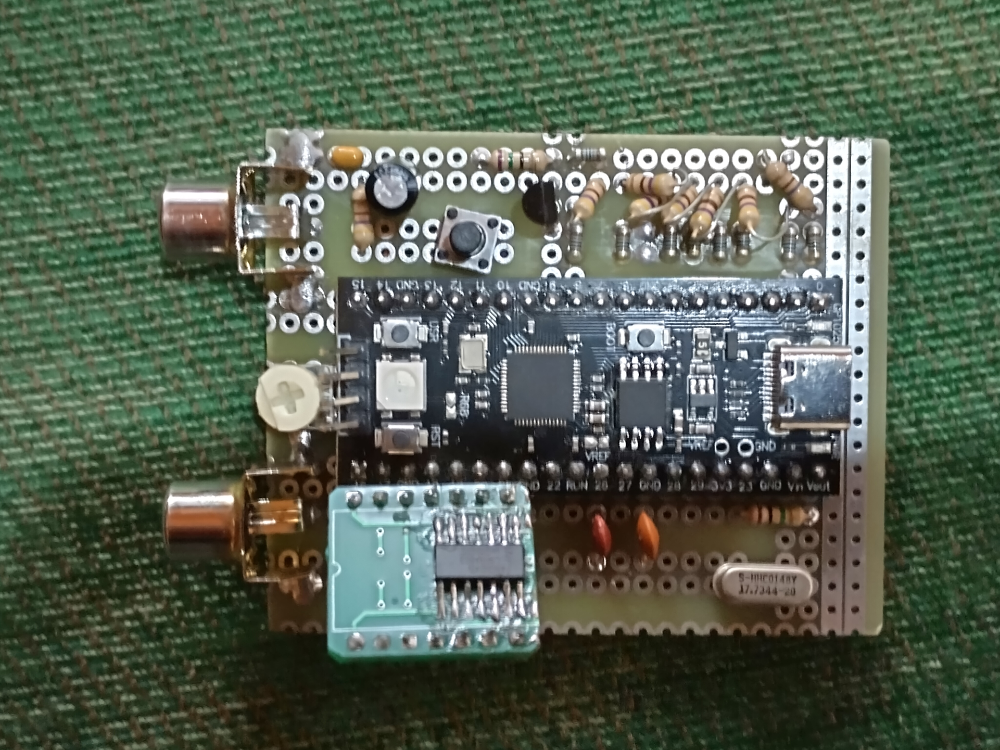
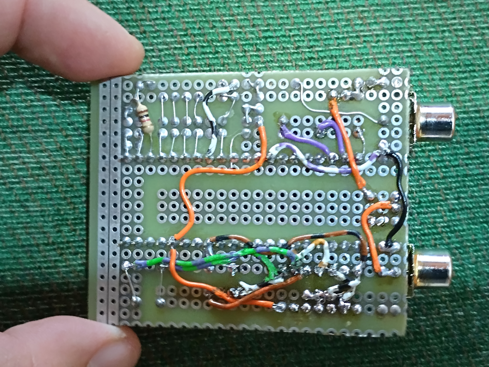
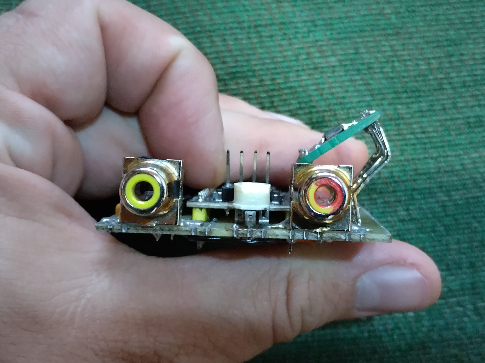
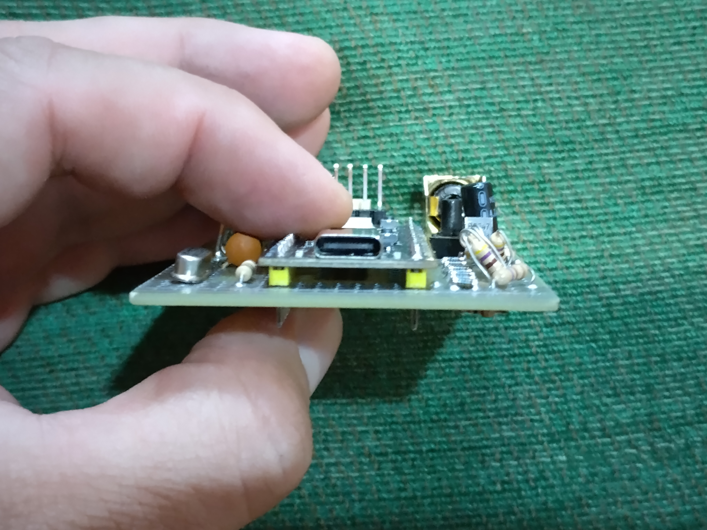
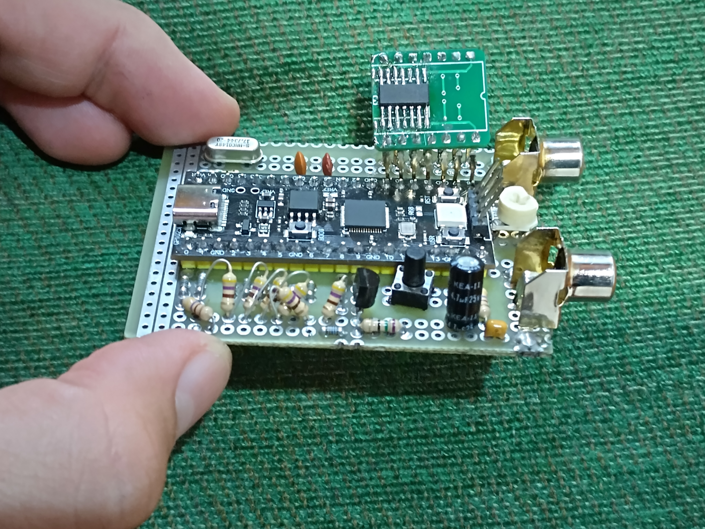

- Пълен PAL композитен видеосигнал по стандарт: точно 1,135 семпъла на ред ($64.00\ \mu\text{s}$, $283.75$ периода на подносещата на ред), фазово завъртане $-90^\circ$/ред, непрекъсната 4-кадрова / 8-полукадрова (2,500-редова) PAL последователност, синхронизация, изравнителни импулси, цветен burst, V-switch и 2:1 презредова развивка
- Съвместим с CRT/LCD телевизори, AV2HDMI конвертори, стандартни кепчър карти и стриктни софтуерни TBC декодери за суров захват като **CXADC + `cvbs-decode`** (както 2D, така и 3D PAL гребенови филтри)
- 8 тестови таблици, превключваеми чисто в реално време с един бутон (с черна завеса по време на преизчисляването, за да няма разкъсване на картината при смяна)
- Глобално инжектиране на **Телетекст в VBI** (стандарт ETS 300 706, страница 100) на редове 16–18 и 329–331 при всички 8 тестови таблици
- Двуядрена архитектура: **Core 1** е посветено изцяло на композирането на видеоредовете и DMA предаването от SRAM без джитър, докато **Core 0** обслужва бутона, LED индикатора и изграждането на таблиците
- Пикселна тактова честота, синхронизирана с кварц 17.734475 MHz ($4 \times f_{sc}$), осигуряваща точни фазови съотношения
- Кръгово маскиране с точност до пиксел (както при оригиналната PM5544) и 32-битово ускорен контур без празнини
- Цифрови филтри на място (без използване на стеков буфер): 3-отводен FIR филтър за яркост върху шаблоните и 5-отводен режекторен филтър на 4.43 MHz за монохромната мрежа и шахматната дъска за потискане на паразитните цветни артефакти
- Синусоидален тестов тон от 1 kHz чрез PWM и DMA, с RC филтриране и потенциометър за регулиране на силата на звука
- LED индикатор за активност, който остава светнат, докато бутонът е натиснат (полезен за проверка на окабеляването)

## Тестови таблици

| № | Изображение | Таблица | Бележки |
|---|-------------|---------|---------|
| 0 | 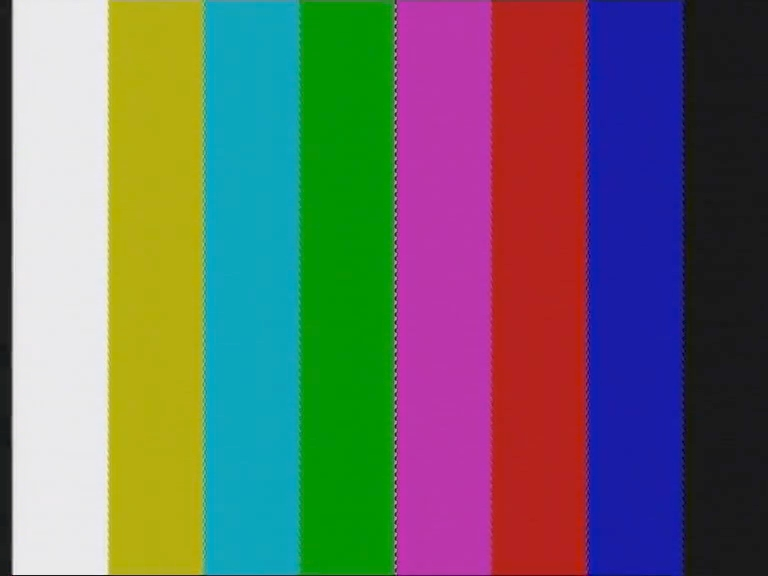 | EBU цветни ленти | Стартова таблица; 100% ленти с PAL burst |
| 1 | 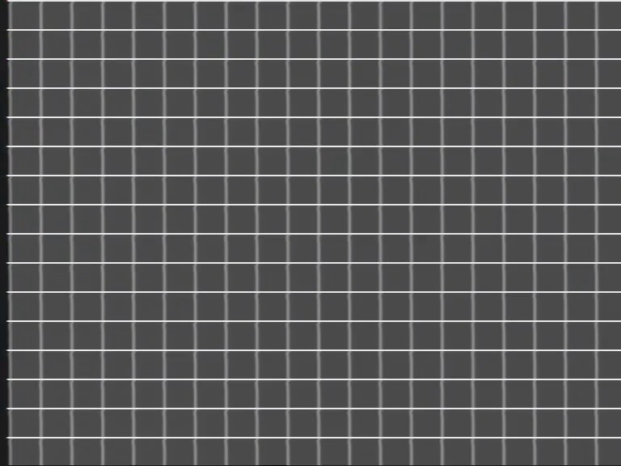 | Кръстосана мрежа | Бяла мрежа върху тъмносив фон, с режекторен филтър на 4.43 MHz |
| 2 |  | Шахматна дъска | Черно-бели клетки с размер 47 px, с режекторен филтър на 4.43 MHz |
| 3 | 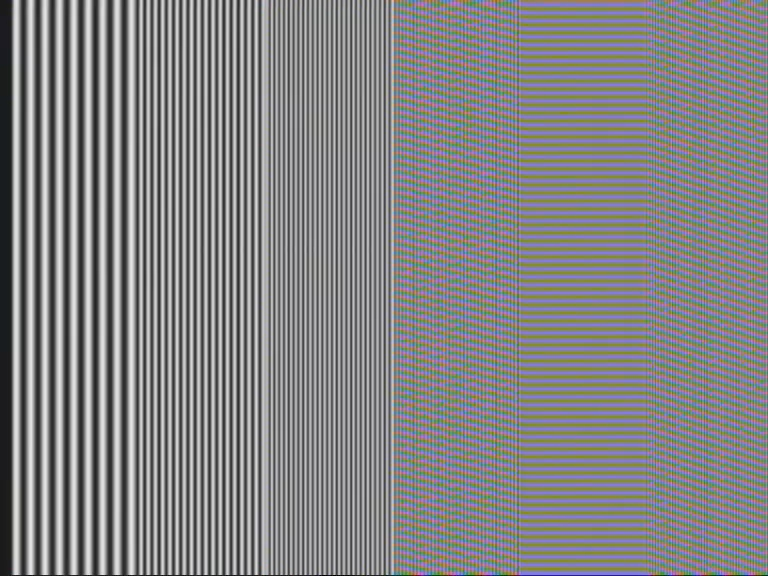 | Multiburst | Нефилтрирани синусоидални пакети на 1.0, 2.0, 3.0, 4.0, 4.43 и 5.0 MHz за тест на Y/C разделянето и честотната лента |
| 4 | 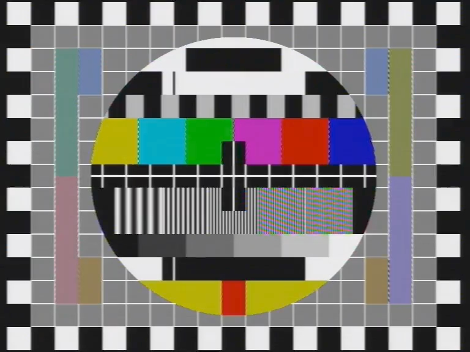 | **Philips PM5544** | Кръгова структура, проверки на НЧ/отражения, цветни ленти, решетки, градации на сивото, проверка на Y/C закъснението, цветни странични сигнали |
| 5 | 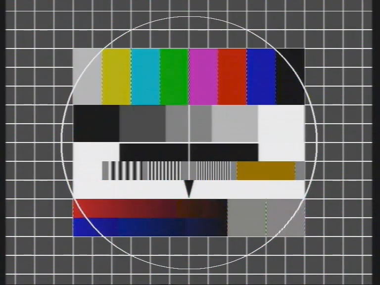 | **Telefunken FuBK** | Цветни ленти, градации на сивото, решетки, PAL тестови сектори, стесняващ се триъгълник |
| 6 | 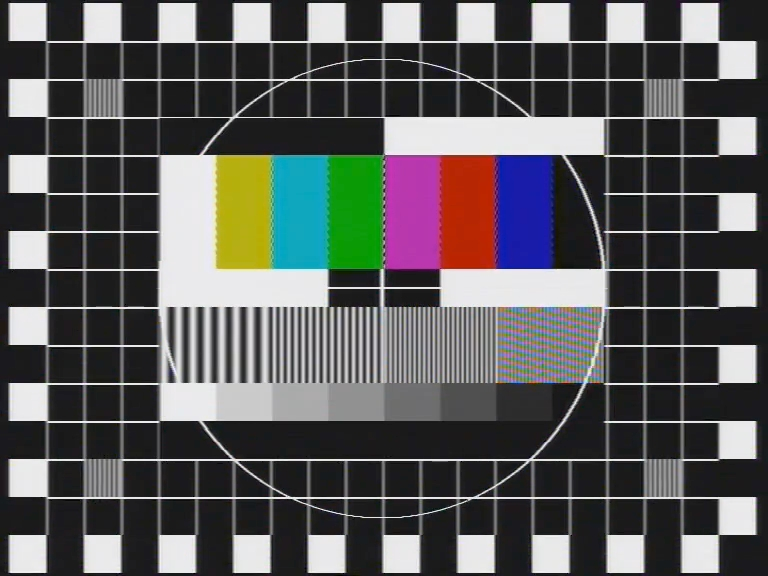 | **Grundig VG1001** (българска модификация, използвана от БНТ, „Нова телевизия“ и „7 дни ТВ“) | Назъбена рамка, централно поле с цветни ленти, решетки и градации на сивото |
| 7 | 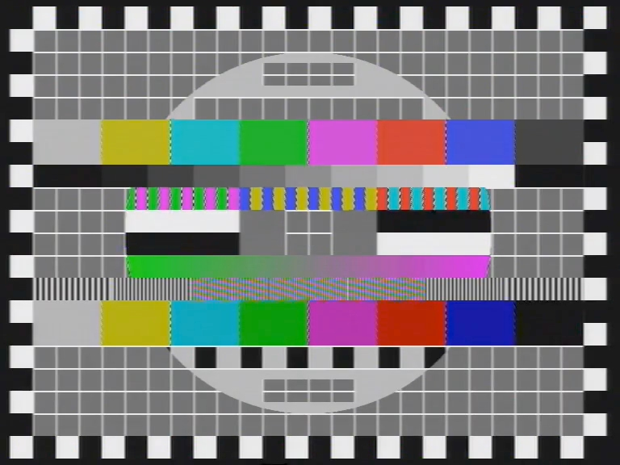 | **UEIT** | Решетка $26 \times 20$ клетки, цветни ленти, градации на сивото, ивици, наклонени/градиентни полета, решетки (понастоящем без кръгове в ъглите) |

Натиснете бутона, за да преминете към следващата таблица. След таблица 7 изборът се връща към таблица 0.

## Хардуер

### Електрическа схема

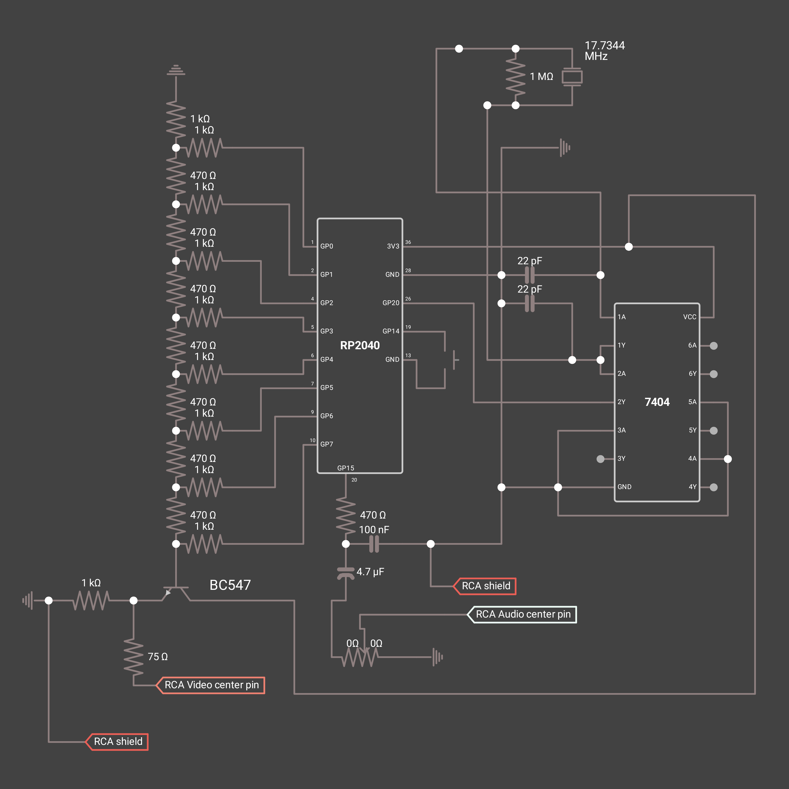

### Списък на компонентите

| Компонент | Стойност / тип | Предназначение |
|-----------|----------------|----------------|
| U1 | YD-RP2040 board | Микроконтролер (без овърклок, с външен тактов сигнал) |
| U2 | 74HCU04D шестканален инвертор | Кварцов осцилатор и буфер на тактовия сигнал |
| Y1 | 17.7344 MHz кварц | Пикселна тактова честота ($4 \times$ PAL подносеща, номинално 17.734475 MHz) |
| R | $1\text{ M}\Omega$ | Обратна връзка на осцилатора |
| C | $2 \times 22\text{ pF}$ | Кондензатори за товара на кварца |
| R-2R стълбица | $8 \times 1\text{ k}\Omega$, $8 \times 470\ \Omega$, $1 \times 1\text{ k}\Omega$ терминиращ | 8-битов видеосигнален ЦАП |
| Q1 | BC547 (NPN транзистор) | Емитерен повторител на изхода |
| R | $1\text{ k}\Omega$ | Изтеглящ резистор към маса на емитера |
| R | $75\ \Omega$ | Последователен изходен резистор (импеданс на източника) |
| C (по избор) | $220\text{ pF}$ (керамичен, от изхода към GND) | Възстановяващ нискочестотен филтър за потискане на огледалната съставка на 13.3 MHz от ЦАП |
| R | $470\ \Omega$ | Аудио нискочестотен филтър |
| C | $100\text{ nF}$ | Аудио нискочестотен филтър |
| C | $4.7\ \mu\text{F}$ | Разделяне по постоянен ток в аудиосигнала |
| RV1 | Потенциометър (сила на звука) | Ниво на аудиосигнала |
| SW1 | Моментен бутон | Избор на таблица |
| J1, J2 | RCA конектори | Видео и аудио изходи |

### Разпределение на пиновете

| Пин на RP2040 | Функция |
|---------------|---------|
| GP0–GP7 | 8-битов видеосигнален ЦАП (GP0 = LSB, GP7 = MSB) |
| GP14 | Бутон за избор на таблица (към GND, с вътрешен pull-up) |
| GP15 | PWM изход за аудиосигнала |
| GP20 | Вход за външен тактов сигнал (от осцилатора с 74HCU04) |
| GPIO25 | Вграден LED (индикатор за активност) |
| 3V3 / GND | Захранване за 74HCU04, колектора на BC547 и опорния сигнал на ЦАП |

### Тактов сигнал

Използват се два логически елемента на 74HCU04D. Първият (1A към 1Y), заедно с резистора за обратна връзка $1\text{ M}\Omega$, кварца и двата кондензатора $22\text{ pF}$, образува Pierce осцилатор. Нарочно се използва небуфериран (U-тип) инвертор, тъй като в тази роля той работи като линеен усилвател. Вторият логически елемент (2A към 2Y) буферира изхода на осцилатора и го подава към GP20. Неизползваните входове на логическите елементи са фиксирани към определено логическо ниво.

След това RP2040 превключва `clk_sys` директно към този външен тактов сигнал (`GPIN0` като допълнителен източник на `clk_sys`). Системната тактова честота е заключена точно на 17.734475 MHz, с една PIO инструкция на пиксел ($56.39\text{ ns}$ на семпъл).

### Видеосигнален ЦАП и изходен каскад

GP0–GP7 подават сигнала към резисторна стълбица от тип R-2R ($1\text{ k}\Omega$ за клоновете „2R“, $470\ \Omega$ за последователните елементи „R“ и $1\text{ k}\Omega$ терминиращ резистор към маса). Изходът на стълбицата управлява базата на емитерен повторител с BC547. Колекторът е свързан към 3V3, а емитерът подава сигнала към резистор $1\text{ k}\Omega$ към маса и последователен резистор $75\ \Omega$ към централния пин на RCA конектора, осигурявайки импеданс на източника $75\ \Omega$. Добавянето на $220\text{ pF}$ керамичен кондензатор между композитния изход и маса е препоръчително при суров RF/baseband захват (напр. с CXADC), за да изглади стъпаловидната огледална съставка на 13.3 MHz от ЦАП, без да засяга видеочестотната лента.

Нива на сигнала (8-битови кодове на ЦАП):

| Ниво | Код |
|------|-----|
| Връх на синхроимпулса | 70 |
| Черно / гасене | 116 |
| Тъмносиво | 143 |
| Сиво | 170 |
| Телетекст „1“ (66%) | 188 |
| Бяло | 224 |

### Аудио

GP15 извежда PWM сигнал (wrap стойност 276, приблизително 64 kHz носеща честота). Синусоидална таблица с 64 стойности се подава циклично към PWM регистъра за сравнение чрез два свързани DMA канала (за данни и управление), което генерира **тон от 1 kHz** без натоварване на процесора. RC мрежа $470\ \Omega$ + $100\text{ nF}$ филтрира носещата честота, кондензатор $4.7\ \mu\text{F}$ блокира постоянната съставка, а потенциометър задава нивото на сигнала към централния пин на RCA конектора.

## Как работи

### Времедиаграма и точен PAL такт от 1,135 семпъла

- 625 реда на кадър, 2:1 презредова развивка, 576 видими реда
- **1,135 семпъла на ред** при 17.734475 MHz = точно **$64.00\ \mu\text{s}$** ($283.75$ периода на подносещата на ред), отговарящо на broadcast PAL стандарта с фазово завъртане $-90^\circ$/ред
- Тъй като 1,135 не се дели точно на 4 байта, четири последователни реда ($4 \times 1135 = 4540\text{ байта} = 1135\text{ 32-битови думи}$) се предават с 32-битов DMA цикъл **`284, 284, 284, 283` думи**
- Помощната функция `pack_line_1135()` измества всеки буфер за фаза `s_mod = line_idx & 3` наляво с `s_mod` байта и допълва последните 1–3 байта с `SYNC_TIP` (началото на хоризонталния синхроимпулс на следващия ред), запазвайки 32-битовата ефективност на DMA при напълно фазово-непрекъснат поток от 1,135 семпъла на ред
- Последователността се повтаря на всеки **4 кадъра (2,500 реда)**, покривайки пълната **8-полукадрова PAL цветова последователност** с `phase_offset = {0, 3, 2, 1}` и редуващ се PAL V-switch (`v_inverted`)

### Двуядрен път на сигнала

```text
Main SRAM0-3 buffers --> Core 1 Segmented DMA --> SCRATCH_X/Y ping/pong --> PIO DMA --> PIO --> GP0-GP7 --> R-2R DAC --> BC547 --> RCA
```

1. **PIO (`video.pio`)**: програма с една инструкция `out pins, 8` с праг за автоматично извличане от 32 бита. Всяка 32-битова дума от FIFO се превръща в четири 8-битови пиксела — по един за всеки тактов импулс.
2. **Самостоятелен видеодвигател на Core 1**: **Core 1** обслужва ексклузивно `DMA_IRQ_0` и изчаква в `__wfi()` в SRAM, което напълно елиминира забавянията от XIP Flash кеш-пропуски в строгия бюджет от 1,132 такта (при `283`-думния ред).
3. **Ping-pong DMA в `SCRATCH_X` / `SCRATCH_Y`**: `ping_buf` е разположен в `SCRATCH_X` (SRAM4), а `pong_buf` — в `SCRATCH_Y` (SRAM5). Тъй като буферите на таблиците са в основната банка SRAM0–3, изходният DMA към PIO и композиращият DMA работят без колизии по шината на паметта.
4. **Сегментиран DMA композитор с нулеви излишни копирания (`dma_isr` / `compose_line`)**: докато единият буфер се извежда към PIO, Core 1 изгражда следващия ред в другия. Предварително конфигуриран трети DMA канал копира левия фон, вътрешния шаблон (`special_table[]`) и десния фон на три неприпокриващи се сегмента, подрязва 0–3 гранични байта за пикселна точност на кръга през четирите кадъра (без трептене на ръба) и изчертава контура с 32-битов цикъл. Директен брояч `current_frame_line` (`0..624`) премахва бавното софтуерно деление `% 625` в прекъсването.
5. **Чиста смяна на таблиците (синхронизация между Core 0 и Core 1)**: при натискане на бутона Core 0 вдига флага `switching_card` и изчаква Core 1 да потвърди `video_blanked`. Докато Core 0 преизчислява буферите на новата таблица, Core 1 синтезира чисти 1,135-семплови черни редове и VSYNC/EQ импулси директно в scratch RAM без четене от основната RAM, премахвайки смущенията при превключване.
6. **Аудио**: независима двойка свързани DMA канали подава циклично `audio_lut` към PWM регистъра за сравнение.

### Генериране на цветовете и цифрово филтриране

PAL цветоносната информация се синтезира при $4 \times f_{sc}$, така че всеки период на подносещата обхваща точно 4 семпъла. $U$ и $V$ се добавят към яркостта според `(x + phase_offset[s_mod]) % 4`, като $V$ се инвертира на всеки следващ ред. Цветният burst в `generate_hblank()` следва същото фазово завъртане.

Всички цифрови филтри работят **на място (in-place) без заделяне на стеков буфер**, което запазва минимален разход на стек на Core 0:
- **3-отводен FIR нискочестотен филтър (`apply_luma_lpf`)**: смекчава резките яркостни преходи в шаблоните преди нанасянето на цветните ленти и честотните решетки.
- **5-отводен режекторен филтър на 4.43 MHz (`apply_chroma_notch`)**: използва ядро $[0.25, 0, 0.5, 0, 0.25]$, което създава математическа нула точно при $f_{sc} = f_s / 4$ и потиска паразитните цветове върху монохромната мрежа и шахматната дъска.
- **Нефилтриран Multiburst**: синусоидалните пакети в `build_multiburst()` са оставени умишлено нефилтрирани, за да тестват реалното Y/C разделяне на приемника или кепчър картата.

### Инжектиране на Телетекст (VBI)

`teletext.c` генерира Телетекст **страница 100** по стандарт ETS 300 706 (1 заглавен ред + 2 цветни текстови реда) с нечетна четност за ASCII, Hamming 8/4 защита и преплитане на битовете за списание и ред (`ttx_mrag`). Тъй като битрейтът на Телетекста е 6.9375 MHz при пикселна честота 17.734475 MHz ($\approx 2.5563$ пиксела на бит), фазов акумулатор с плаваща запетая генерира NRZ потока, а 5-отводен Гаусов филтър на място (`apply_teletext_filter`) премахва алайъсинга, така че декодерите да се синхронизират стабилно по Clock Run-In импулсите.

`compose_line()` на Core 1 подменя VBI редове **16–18** (първо поле) и **329–331** (второ поле) глобално, така че страница 100 присъства автоматично при всички 8 тестови таблици.

### Памет

Всички линейни буфери са подравнени на 32 бита за бързи DMA трансфери и заемат около 245 KB от наличните 264 KB SRAM на RP2040 (като `ping_buf` и `pong_buf` са изолирани в SRAM4/SRAM5). Картите споделят буфери чрез `#define` алиаси (виж `ueit.c` и `vg1001_bnt.c`), а филтрите на място гарантират, че стекът на Core 0 в `SCRATCH_Y` никога не се припокрива с `pong_buf`.

## Структура на изходния код

| Файл | Описание |
|------|----------|
| `main.c` | Настройка на хардуера, външен такт, конфигуриране на PIO и DMA, `pack_line_1135`, видеокомпозитор и ISR на Core 1, черна завеса при смяна, бутон/LED цикъл на Core 0 |
| `video.pio` | PIO програма, която извежда 8-битови пиксели при $4 \times f_{sc}$ |
| `pm5544.c` | Шаблони за синхронизация/гасене, генериране на burst, споделени помощни функции (`fill_color_bar`, in-place `apply_luma_lpf`, overlays) и генераторът на PM5544 |
| `fubk.c` | Карта Telefunken FuBK |
| `vg1001_bnt.c` | Карта Grundig VG1001 (българска модификация, използвана от БНТ, „Нова телевизия“ и „7 дни ТВ“) |
| `ueit.c` | Карта UEIT (Универсальная электронная испытательная таблица / УЭИТ), без кръговете в ъглите (реализирането им надхвърля хардуерните ограничения на платката) |
| `simple_patterns.c` | EBU цветни ленти, кръстосана мрежа, шахматна дъска (с in-place `apply_chroma_notch`) и multiburst |
| `teletext.c` | ETS 300 706 VBI Телетекст енкодер (Hamming 8/4, нечетна четност, MRAG, фазов акумулатор, 5-отводен Гаусов филтър) |
| `CMakeLists.txt` | Конфигурация за компилиране с Pico SDK (свързва `pico_multicore`) |

Изходните файлове на картите и Телетекста се `#include`-ват в `main.c`, така че целият проект се компилира като една преводна единица.

## Компилация

Изисквания: Raspberry Pi Pico SDK (със зададен `PICO_SDK_PATH`), CMake $\ge 3.13$ и ARM GCC toolchain.

```bash
git clone https://github.com/AleSla/Pico-PAL-Test-Card-Generator.git
cd Pico-PAL-Test-Card-Generator
mkdir build && cd build
cmake ..
make -j
```

Компилацията създава `pico_pal_generator.uf2`.

## Флашване

1. Задръжте **BOOT** на YD-RP2040 и свържете USB (или натиснете RESET, докато държите BOOT).
2. Копирайте `pico_pal_generator.uf2` към появилото се устройство `RPI-RP2`.

> **Платката се нуждае от външния тактов сигнал, за да работи.** Фърмуерът превключва `clk_sys` към GP20 малко след стартиране. Ако осцилаторът 17.7344 MHz не работи, платката ще спре. Флашвайте я при свързан осцилатор или задръжте BOOT при включване на захранването.

## Използване

1. Свържете видео RCA конектора към PAL монитор, телевизор или устройство за захващане на видео (вход $75\ \Omega$).
2. Захранете платката през USB.
3. Натиснете бутона на GP14, за да преминавате през 8-те тестови таблици.
4. По желание отворете **Телетекст страница 100** на телевизора или VBI декодера, за да видите инжектираните редове.
5. По желание свържете аудио RCA конектора за тестовия тон от 1 kHz.

## Известни проблеми и бележки

- **Паразитни цветове (cross-color) при Multiburst ($\ge 3.5\text{ MHz}$):** Появата на цветни ивици върху пакетите от 4.0–5.0 MHz е нормална физика на аналоговия композитен видеосигнал, тъй като високочестотната яркост попада в лентата на 4.43 MHz цветния подносител. Multiburst е оставен умишлено нефилтриран за оценка на Y/C гребеновия филтър на приемника.
- **Захват с CXADC / `cvbs-decode`:** Благодарение на точния 1,135-семплов ($283.75$-периоден) такт и 8-полукадровата PAL последователност, `cvbs-decode` заключва чисто `phaseID` и декодира пълни цветове както в режим Transform PAL 2D, така и в 3D. Ако при захват се наблюдават изпуснати семпли или колебаеща се дължина на реда, записвайте директно в `/dev/shm` с изключен AGC (`sixdb=0`, `level=0`), за да избегнете препълване на буферите от дисковия I/O.
- **Ограничение на SRAM за Телетекст:** Настоящият предварително изчислен 3-редов Телетекст блок (1 заглавен + 2 текстови реда в 4 фазови варианта, $\approx 13.6\text{ KB}$) е близо до лимита от 264 KB SRAM на RP2040; добавянето на повече страници или редове изисква динамично генериране или каруселно обновяване от Core 0.

## Персонализиране

- **Нива**: `SYNC_TIP`, `BLACK_LEVEL`, `DARK_GRAY_LEVEL`, `GRAY_LEVEL`, `WHITE_LEVEL` в началото на `main.c`
- **Текст на Телетекста**: редактирайте `hdr_text`, `r1_text` и `r2_text` в `build_teletext_vbi()` във файла `teletext.c`
- **Честота на тона**: променете PWM wrap стойността или дължината на `audio_lut`
- **Нови карти**: добавете функция `build_xxx()`, която запълва буферите, извиква `pack_line_1135(..., s_mod)` в края на `s_mod` цикъла, попълва `base_table` и `special_table`, и я регистрирайте в обработчика на бутона в `main()`

## Благодарности

- Тестовите карти Philips PM5544, Telefunken FuBK, Grundig VG1001 и UEIT са дело на техните оригинални дизайнери. Този проект представлява независимо хоби възпроизвеждане с цел тестване на оборудване.

## Лиценз

Лицензиран съгласно лиценза GPL-3.0.